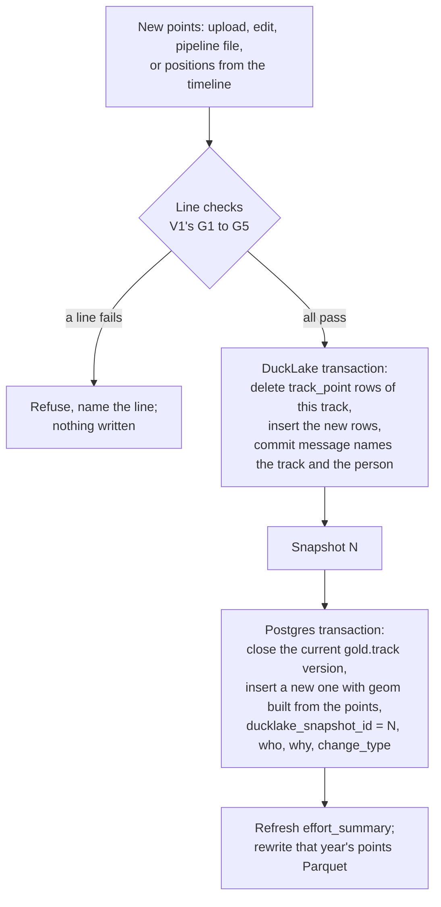
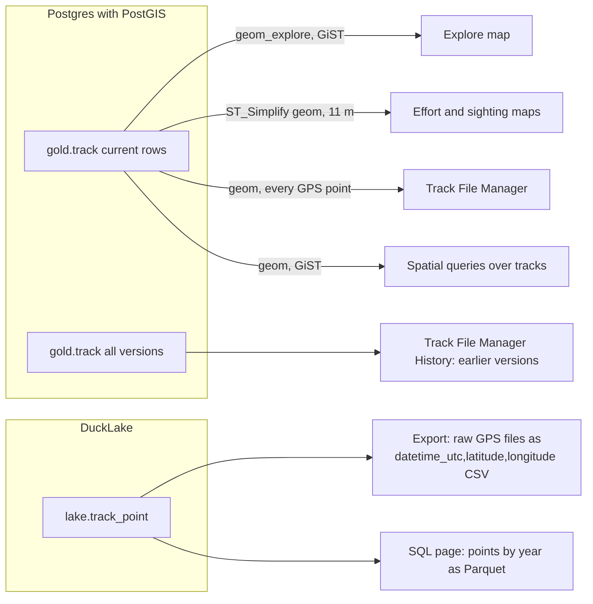

# GPS Track Storage: DuckLake and PostGIS

How GPS points are stored, written and read (decision 003). DuckLake is the source of truth for points. In Postgres, each version of a track is one row of `gold.track`, and its `geom` holds every GPS point as a `MultiLineStringM`. The site and spatial queries read that.

## Pieces

| Piece | Where | Holds |
|---|---|---|
| DuckLake catalog | `ducklake` schema in the site's Postgres database | DuckLake's own metadata: tables, snapshots, file lists. It is backed up with the database. |
| DuckLake data | Parquet files on the droplet's disk, under the data path (for example `/srv/unified-db/ducklake/`) | `track_point`, every GPS point ever written, in every version. |
| `gold.track` | Postgres with PostGIS | One row per track version: file name, status, matched effort, `ducklake_snapshot_id`, and `geom`. Generated columns add Explore's line, the point count, the length and the top speed. |

The site attaches the lake with DuckDB:

```sql
ATTACH 'ducklake:postgres:dbname=unified' AS lake (DATA_PATH '/srv/unified-db/ducklake/');
```

## The DuckLake Table

```sql
CREATE TABLE lake.track_point (
    track_id  BIGINT,       -- gold.track.id
    seq       INTEGER,      -- position in the file, from 1; the Track File Manager's line number
    point_time TIMESTAMPTZ, -- UTC
    lon       DOUBLE,
    lat       DOUBLE
);
ALTER TABLE lake.track_point SET PARTITIONED BY (year(point_time));
```

- **Partitioned by year.** At V1's volume that's about 1 million points and 10 MB a year, so a year's files stay small, and the SQL page's points-by-year Parquet (decision 005) maps one-to-one.
- **Sorted.** Rows are written ordered by (`track_id`, `seq`), so reading one track touches few row groups.
- **Size.** All 10.4 million points take about 116 MB (data profile, `track_parquet_size_estimate`).
- **Snapshots are never expired.** Merging small files (`ducklake_merge_adjacent_files`) is allowed.

## The PostGIS Geometry

`gold.track.geom` is a `geometry(MultiLineStringM, 4326)`:

- **Vertices:** one per GPS point, in file order. X and Y are longitude and latitude, and M is the point's time in seconds since 1970 (UTC). The Track File Manager's line N is vertex N across the parts.
- **Parts:** a new part starts wherever two consecutive GPS points are more than 60 s apart. Sixty seconds is the smallest gap the settings allow (TRACK-04: more than N minutes, N from 1).
  - Inside a part, no step can ever count as a time gap.
  - At each part boundary, the browser compares the two M values with the user's minutes, and draws the jump as a gap or as ordinary line (TRACK-05, TRACK-06).
- **Distance and speed rules:** checked between consecutive vertices of whatever line was sent.
  - On effort and sighting maps (11 m) and in the Track File Manager (every GPS point), that is exact or nearly so.
  - On Explore's 550 m line it is approximate, which is acceptable at that zoom.
- **Size:** 10.4 million vertices of three doubles is about 250 MB before Postgres compresses it. The largest track (49,504 points) is about 1.2 MB.

**Generated columns** need no code to keep them right:

| Column | Expression | Serves |
|---|---|---|
| `geom_explore` | `ST_Simplify(geom, 0.005)` (about 550 m) | Explore's tracks, with a GiST index (MAP-05, EXPL-02) |
| `point_count` | `ST_NPoints(geom)` | Track card, Explore popup (EDET-08, EXPL-05) |
| `length_nm` | `gold.track_length_nm(geom)`, along the GPS points and not across part jumps | Track card, distance check (EDET-07) |
| `top_knots` | `gold.track_top_knots(geom)`, the fastest step including across part boundaries | Suspect when over 40 kn (TRACK-02) |

Track Health's other counts (GPS points out of time order, repeated rows, gaps under the default rules) are computed from `geom` when the Track File Manager opens a track. That's one row, so it's quick.

## Write Path

Every change to a track's points comes from one of three places:
- The Track File Manager: import, save, revert, fill from file, create from positions, delete, restore.
- A pipeline load.

All three go through one function (Phase 5):



- **Line checks:** V1's checks (`datahealth/gps/tracks.py`), audited when the code is written.
- **Building `geom`:** the points are sorted by `seq` and split into parts at steps over 60 s, then written as `ST_GeomFromText('MULTILINESTRING M (...)', 4326)` or through `ST_MakeLine` on `ST_MakePointM`. The generated columns fill themselves.
- **Commit messages:** the DuckLake commit message records the track ID, the person and the action, so the nightly check can rebuild a missing Postgres version from DuckLake alone. Phase 4 confirms the call against the installed version.
- **Delete:** delete the track's rows in DuckLake (a new snapshot), and insert a `deleted` version of `gold.track`.
- **Restore:** copy an earlier `gold.track` version, `geom` included, as a new version. Write its points back to DuckLake as a new snapshot.

## Keeping Postgres in Step

The write path is one function, so `geom` normally changes with every write. If the Postgres step fails after DuckLake committed, or someone changes the lake by hand, the nightly job (with TFM-07's checks) repairs it:

1. For each track, find the newest snapshot whose commit names it.
2. If it is newer than the current version's `ducklake_snapshot_id`, read the points at that snapshot and write the missing version (who and why from the commit message).
3. Report every repair in the Server event log.

## Read Path



- **Maps read PostGIS only** (MAP-06), through the one track component (TRACK-01):
  - Explore gets `geom_explore` for the matching efforts whose line crosses the view.
  - Effort and sighting maps get one track simplified to about 11 m with `ST_Simplify(geom, 0.0001)`, which keeps the M of kept vertices.
  - The Track File Manager gets `geom` whole.
- **DuckLake is read for files, not maps:** Export's raw GPS files (V1's cleaned-file format, EXP-07) and the SQL page's points Parquet.

## Backup and Restore

The DuckLake catalog is in the Postgres dump, and the data path is a folder of Parquet files. Back up both together: dump Postgres first, then copy the data path. Files are only added, never changed in place, so the copy holds every file the dump names. Phase 4 sets this up and tests a restore.

## What Phase 4 Must Confirm

- The installed DuckLake version supports a Postgres catalog, `SET PARTITIONED BY`, and commit messages with extra info.
- `ST_Simplify` on a `MultiLineStringM` keeps the M values. Building and simplifying the largest track (49,504 points) stays well under a second.
- A restore from backup brings back both the catalog and the files.
