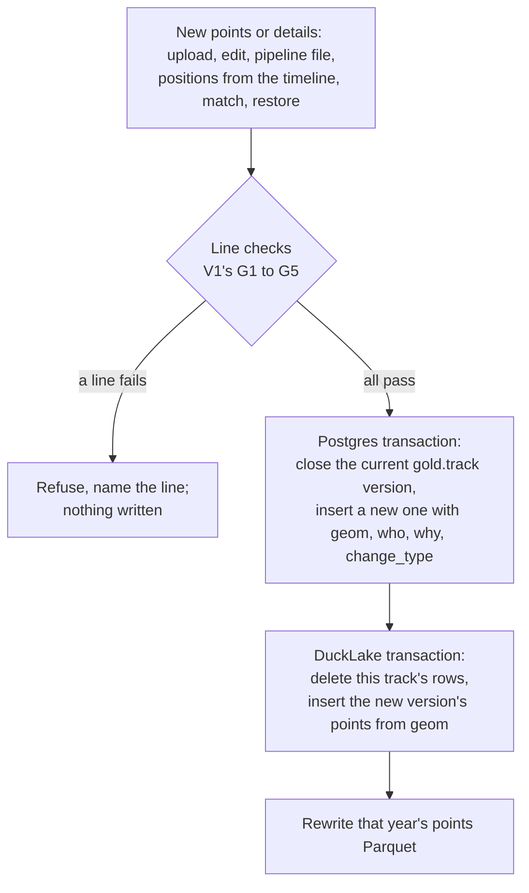
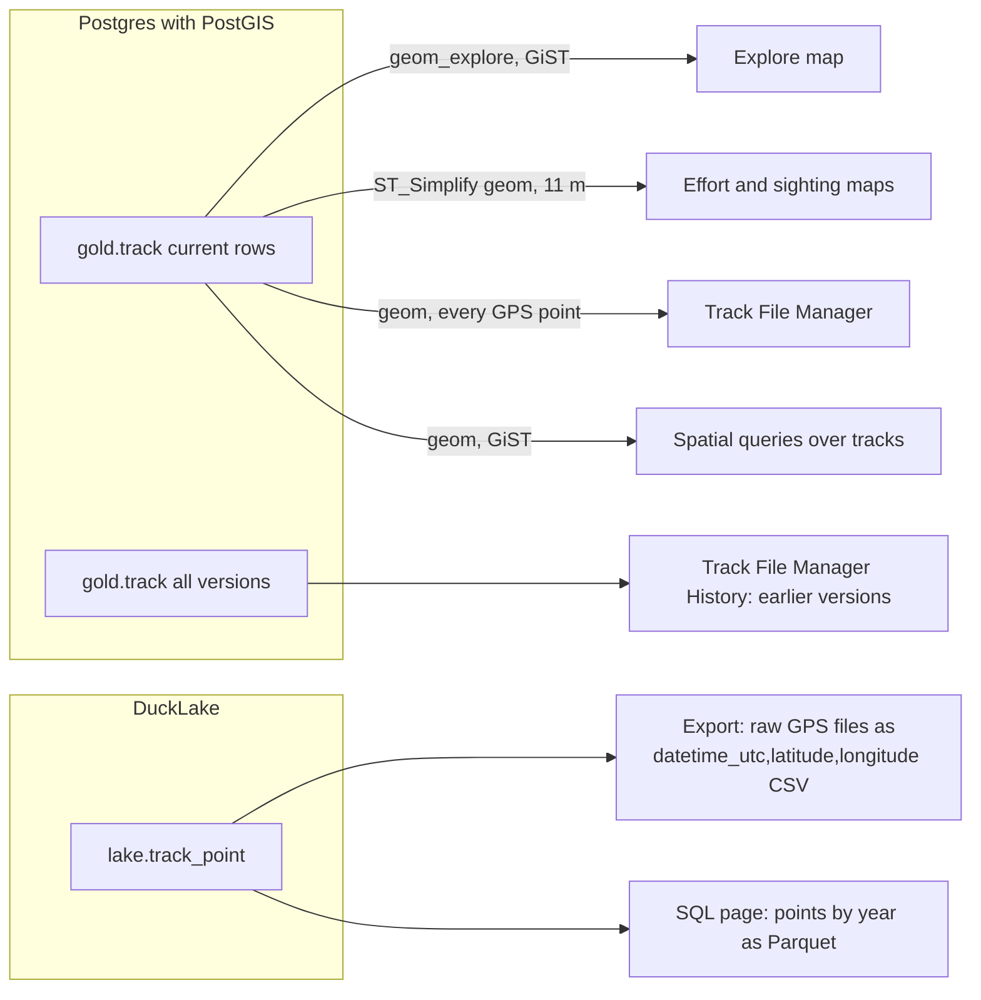

# GPS Track Storage: PostGIS and a DuckLake Copy

How GPS points are stored, written and read (decision 003). In Postgres, each version of a track is one row of `gold.track`, and its `geom` holds every GPS point as a `MultiLineStringM`. That row is the source of truth, and the site and spatial queries read it. DuckLake holds a copy of each current track's points, written after every save, for the SQL page and raw file exports (Q-082).

## Pieces

| Piece | Where | Holds |
|---|---|---|
| `gold.track` | Postgres with PostGIS | One row per track version: file name, matched effort, who and why, and `geom`. Generated columns add Explore's line, the point count, the length and the top speed. Every version keeps its points, so History and Restore need nothing else. |
| DuckLake catalog | `ducklake` schema in the site's Postgres database | DuckLake's own metadata: tables, snapshots, file lists. |
| DuckLake data | Parquet files on the droplet's disk, under the data path (for example `/srv/unified-db/ducklake/`) | `track_point`: the points of each current track, copied from `geom`. |

The site attaches the lake with DuckDB:

```sql
ATTACH 'ducklake:postgres:dbname=unified' AS lake (DATA_PATH '/srv/unified-db/ducklake/');
```

## The PostGIS Geometry

`gold.track.geom` is a `geometry(MultiLineStringM, 4326)`:

- **Vertices:** one per GPS point, in file order. X and Y are longitude and latitude, and M is the point's time in seconds since 1970 (UTC). The Track File Manager's line N is vertex N across the parts.
- **Parts:** a new part starts wherever two consecutive GPS points are more than 60 s apart. Sixty seconds is the smallest gap the settings allow (TRACK-04: more than N minutes, N from 1).
  - Inside a part, no step can ever count as a time gap.
  - At each part boundary, the browser compares the two M values with the user's minutes, and draws the jump as a gap or as ordinary line (TRACK-05, TRACK-06).
- **Distance and speed rules:** checked between consecutive vertices of whatever line was sent.
  - On effort and sighting maps (11 m) and in the Track File Manager (every GPS point), that is exact or nearly so.
  - On Explore's 550 m line it is approximate, which is acceptable at that zoom.
- **Size:** 10.4 million vertices of three doubles is about 250 MB before Postgres compresses it. The largest track (49,504 points) is about 1.2 MB.
- **Status** is not stored. `gold.track_current` works it out: Not Matched has no effort, Blank has no points, and the rest are Matched (Q-080).

**Generated columns** need no code to keep them right:

| Column | Expression | Serves |
|---|---|---|
| `geom_explore` | `ST_Simplify(geom, 0.005)` (about 550 m) | Explore's tracks, with a GiST index (MAP-05, EXPL-02) |
| `point_count` | `ST_NPoints(geom)` | Track card, Explore popup (EDET-08, EXPL-05) |
| `length_nm` | `gold.track_length_nm(geom)`, along the GPS points and not across part jumps | Track card, distance check (EDET-07) |
| `top_knots` | `gold.track_top_knots(geom)`, the fastest step including across part boundaries | Suspect when over 40 kn (TRACK-02) |

Track Health's other counts (GPS points out of time order, repeated rows, gaps under the default rules) are computed from `geom` when the Track File Manager opens a track. That's one row, so it's quick.

## The DuckLake Table

```sql
CREATE TABLE lake.track_point (
    track_id    BIGINT,       -- gold.track.id
    version_id  BIGINT,       -- the gold.track version these points were copied from
    seq         INTEGER,      -- position in the file, from 1; the Track File Manager's line number
    point_time  TIMESTAMPTZ,  -- UTC
    lon         DOUBLE,
    lat         DOUBLE
);
ALTER TABLE lake.track_point SET PARTITIONED BY (year(point_time));
```

- **Current tracks only.** Earlier versions live in `gold.track`, so the lake does not keep them.
- **`version_id`** says which version a track's rows came from. The nightly check compares it with the current version. It repeats on every row of a track, so Parquet stores it in almost no space.
- **Partitioned by year.** At V1's volume that's about 1 million points and 10 MB a year, so a year's files stay small, and the SQL page's points-by-year Parquet (decision 005) maps one-to-one.
- **Sorted.** Rows are written ordered by (`track_id`, `seq`), so reading one track touches few row groups.
- **Size.** All 10.4 million points take about 116 MB (data profile, `track_parquet_size_estimate`).
- **Snapshots** may be expired and small files merged (`ducklake_merge_adjacent_files`), since nothing depends on the lake's history.

## Write Path

Every change to a track comes from one of these places:
- The Track File Manager: import, save, revert, fill from file, create from positions, match, unmatch, delete, restore.
- A pipeline load.

Each is a version with the usual change type (`load`, `edit`, `delete` or `restore`). History shows what changed by comparing versions, as on every other record. All of them go through one function (Phase 5):



- **Line checks:** V1's checks (`datahealth/gps/tracks.py`), audited when the code is written. A change that leaves the points alone (match, unmatch, comments) skips them.
- **Building `geom`:** the points are sorted by `seq` and split into parts at steps over 60 s, then written as `ST_GeomFromText('MULTILINESTRING M (...)', 4326)` or through `ST_MakeLine` on `ST_MakePointM`. The generated columns fill themselves.
- **The copy:** the lake's rows are read back from the saved `geom` (`ST_DumpPoints`), so they always match the version in Postgres. A change that leaves the points alone still rewrites them with the new `version_id`. That's one track, so it's quick.
- **Delete:** insert a `delete` version of `gold.track`, then delete the track's rows from the lake.
- **Restore:** copy an earlier `gold.track` version, `geom` included, as a new version, then copy its points to the lake.

## Keeping the Copy in Step

The save is done once Postgres commits. If the DuckLake step then fails, the person's change is kept, and the nightly job (with TFM-07's checks) catches the lake up:

1. Find every current track whose `version_id` differs from the one in the lake, or that has no rows there, and every deleted track that still has rows.
2. Rewrite or delete those tracks' rows, as in the write path.
3. Report every repair in the Server event log.

Because the lake is only a copy, the same job can rebuild it from nothing.

## Read Path



- **Maps read PostGIS only** (MAP-06), through the one track component (TRACK-01):
  - Explore gets `geom_explore` for the matching efforts whose line crosses the view.
  - Effort and sighting maps get one track simplified to about 11 m with `ST_Simplify(geom, 0.0001)`, which keeps the M of kept vertices.
  - The Track File Manager gets `geom` whole.
- **DuckLake is read for files, not maps:** Export's raw GPS files (V1's cleaned-file format, EXP-07) and the SQL page's points Parquet.

## Backup and Restore

The Postgres dump holds every track version with its points, so it is the backup. After a restore, the nightly job's rebuild writes the lake again from `gold.track`. Phase 4 sets this up and tests a restore, including the rebuild.

## What Phase 4 Must Confirm

- The installed DuckLake version supports a Postgres catalog and `SET PARTITIONED BY`.
- `ST_Simplify` on a `MultiLineStringM` keeps the M values. Building and simplifying the largest track (49,504 points) stays well under a second.
- A full rebuild of the lake from `gold.track`, and how long it takes.
- A restore from backup brings back every track, and the rebuild makes the lake match.
