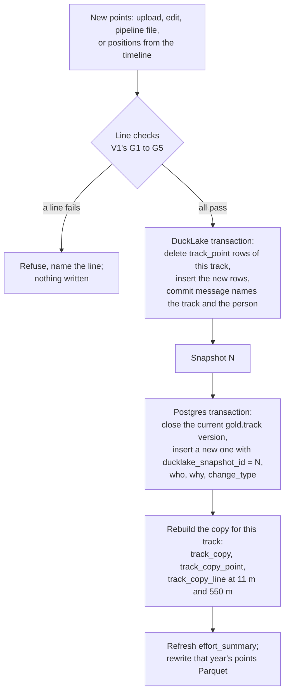
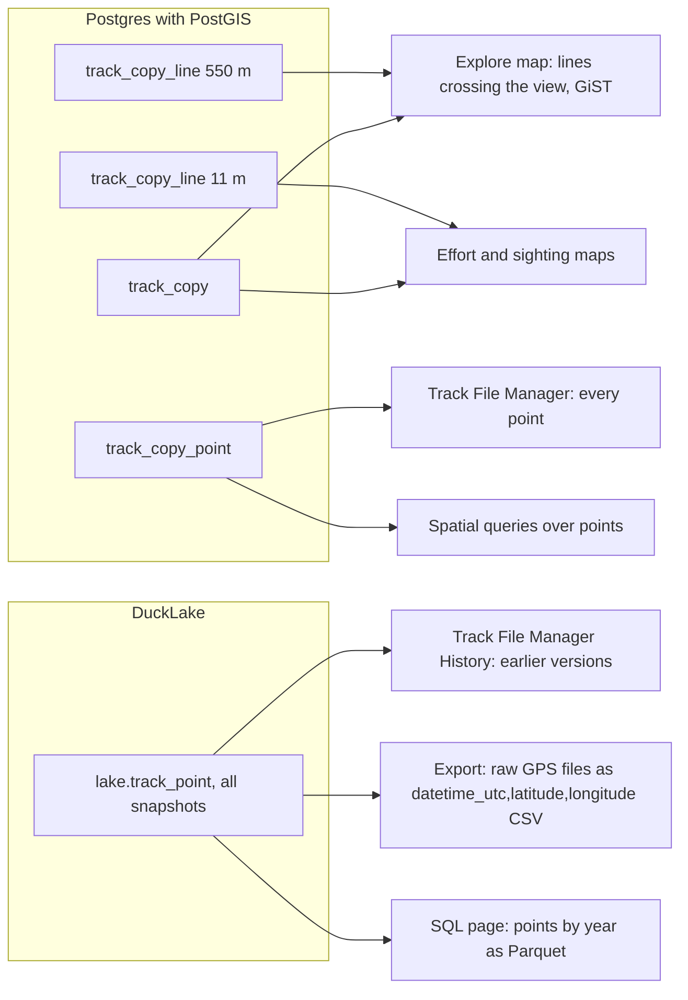

# GPS Track Storage: DuckLake and the PostGIS Copy

How GPS points are stored, written and read (decision 003). DuckLake is the source of truth for points. PostGIS holds a copy that the site and spatial queries read. Track metadata is the versioned `gold.track` table (decision 004).

## Pieces

| Piece | Where | Holds |
|---|---|---|
| DuckLake catalog | `ducklake` schema in the site's Postgres database | DuckLake's own metadata: tables, snapshots, file lists. It is backed up with the database. |
| DuckLake data | Parquet files on the droplet's disk, under the data path (for example `/srv/unified-db/ducklake/`) | `track_point`, every GPS point ever written, in every version. |
| `gold.track` | Postgres | One versioned row per track: file name, status, matched effort, and `ducklake_snapshot_id`, the snapshot holding its current points. |
| `gold.track_copy`, `track_copy_point`, `track_copy_line` | Postgres with PostGIS | The copy: figures, every point, and the 11 m and 550 m lines. |

The site attaches the lake with DuckDB:

```sql
ATTACH 'ducklake:postgres:dbname=unified' AS lake (DATA_PATH '/srv/unified-db/ducklake/');
```

## The DuckLake Table

```sql
CREATE TABLE lake.track_point (
    track_id  BIGINT,       -- gold.track.id
    seq       INTEGER,      -- position in the file, from 1; the Track File Manager's line number
    fix_time  TIMESTAMPTZ,  -- UTC
    lon       DOUBLE,
    lat       DOUBLE
);
ALTER TABLE lake.track_point SET PARTITIONED BY (year(fix_time));
```

- **Partitioned by year.** At V1's volume that's about 1 million points and 10 MB a year, so a year's files stay small, and the SQL page's points-by-year Parquet (decision 005) maps one-to-one.
- **Sorted.** Rows are written ordered by (`track_id`, `seq`), so reading one track touches few row groups.
- **Size.** All 10.4 million points take about 116 MB (data profile, `track_parquet_size_estimate`). Every edit keeps the old version, but edits are rare, so growth is negligible.
- **Snapshots are never expired.** They are the track version history (TFM-04, TFM-08). Merging small files (`ducklake_merge_adjacent_files`) is allowed, because time travel still works after it.

## Write Path

Every change to a track's points comes from one of three places:
- The Track File Manager: import, save, revert, fill from file, create from positions, delete, restore.
- A pipeline load.

All three go through one function (Phase 5), in this order:



**Line checks.** These are V1's checks (`datahealth/gps/tracks.py`), audited when the code is written:
- G1: columns are found by name.
- G2 and G3: impossible times and coordinates are rejected.
- G4: positions must be west of 0.
- G5: gaps are kept as data, not split into files.

**Commit messages.** The DuckLake commit message records the track ID, the person and the action (`set_commit_message`, with the details as extra info). This lets the nightly check rebuild a missing Postgres version from DuckLake alone. Phase 4 confirms the call against the installed DuckLake version.

**Delete.** A delete removes the track's rows in DuckLake (a new snapshot), writes a `deleted` version of `gold.track`, and drops the track's copy rows. Restore reads the points at the snapshot before the delete (`AT (VERSION => n)`) and writes them back as a new snapshot (TFM-08).

**Building the copy.** For one track, DuckDB reads `lake.track_point` at snapshot N. A short Python step (Phase 5) then:
1. Computes `track_copy`:
   - Point count, first and last fix, length in nautical miles, and mean and top speed.
   - `suspect`: true when any step is over 40 kn (TRACK-02, V1's `IMPLAUSIBLE_SPEED_KN`).
   - Fixes out of time order, and repeated rows (TFM-04).
2. Copies every point into `track_copy_point`, in `seq` order.
3. Simplifies the points in time order with Douglas-Peucker on local metres, at 11 m and at 550 m. For each kept vertex it stores the time, plus the largest time step, distance step and speed among the original fixes since the previous kept vertex. That is how the browser finds gaps with each user's rules on a simplified line (TRACK-04, TRACK-06).
4. Writes the three tables with `COPY` in one transaction, replacing the track's old rows.

A 49,504-point track (the largest in V1) is a few hundred milliseconds of work. Rebuilding all 1,552 tracks is a few minutes.

## Keeping the Copy in Step

The write path is one function, so the copy normally changes with every write. Two things can still leave it behind:
- The Postgres step fails after DuckLake committed.
- Someone changes the lake by hand.

The nightly job, which also runs the Track Health checks (TFM-07), reconciles both:

1. For each track, find the newest snapshot whose commit names it.
2. If that is newer than `gold.track.ducklake_snapshot_id`, write the missing track version from the commit message, then rebuild the copy.
3. If `gold.track_copy.ducklake_snapshot_id` differs from the track's snapshot, rebuild the copy.
4. Report every repair in the Server event log.

## Read Path



- **Maps read PostGIS only** (MAP-06), through the one track component (TRACK-01):
  - Explore sends the view's bounding box and the filters, and gets the 550 m lines of matching efforts that cross it (`track_copy_line_explore`).
  - Effort and sighting maps get one track's 11 m line.
  - The Track File Manager gets every point in `seq` order.
- **DuckLake is read directly in three places,** none of them a map of current data:
  - The Track File Manager's earlier versions (time travel).
  - Export's raw GPS files, written in V1's cleaned-file format (EXP-07).
  - The SQL page's points Parquet, rewritten per year when a track in that year changes.

## Backup and Restore

The DuckLake catalog is in the Postgres dump, and the data path is a folder of Parquet files. Back up both together:
1. Dump Postgres.
2. Copy the data path.

Files are only added, never changed in place, so a copy taken after the dump holds every file the dump names. To restore, put back the files, then load the dump. Phase 4 sets this up and tests a restore.

## What Phase 4 Must Confirm

- The installed DuckLake version supports a Postgres catalog, `SET PARTITIONED BY`, commit messages with extra info, and `AT (VERSION => n)`.
- The copy rebuild of the largest track stays under a second on the droplet.
- A restore from backup brings back both the catalog and the files.
