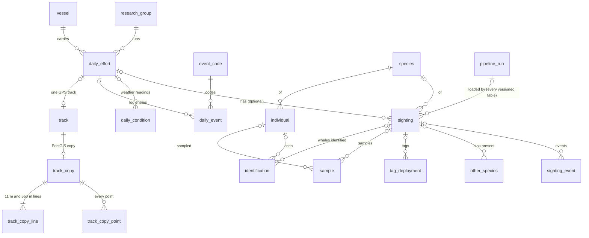

# Gold Schema

The clean data the site reads, in PostgreSQL 18 with PostGIS 3.6. The runnable DDL is [schema.sql](schema.sql). The decisions behind it are in [decisions/](decisions/), and the numbers come from [data-profile.md](data-profile.md). The track storage is in [ducklake.md](ducklake.md), and how changes are recorded is in [audit.md](audit.md).

## Conventions

- **Schemas:**
  - `gold` holds the data.
  - Django's own tables (users, groups, permissions, sessions) stay in `public`.
  - DuckLake keeps its catalog in a `ducklake` schema, which DuckLake creates itself.
- **Keys** (decision 002):
  - Survey records use a hashed 64-bit `id`, and keep the DB167 ID as `legacy_id`. People see and type `legacy_id`, and URLs use it.
  - An individual's `id` is a hash of (catalog, catalog number). Its URL uses the catalog and number, as in `/individuals/mn-20417/`.
  - Lookup tables keep the IDs the pipeline assigns.
- **Times:**
  - Survey dates and times are stored as recorded in the field: `date`, `time`, and `timestamp` without a time zone. This is how DB167 holds them.
  - GPS fixes and version times are `timestamptz` (UTC).
  - Export converts to UTC or Pacific on request (EXP-07).
- **Positions:** `geometry(Point, 4326)`, longitude and latitude. The Parquet export writes them as WKT.
- **No check constraints on measured values.** The profile found Beaufort up to 32 and cloud cover up to 1,002%. Gold stores what the pipeline delivers, and the pipeline's tests flag oddities. Checks exist only on controlled values (codes, statuses, version columns).
- **Long tails go in `extra`** (jsonb): tag deployments, identifications, samples and individuals put rarely used source fields there (decision 001).

## Versioned Tables

Every data table except the lookups holds one row per version of a record (decision 004). These columns end each one. They are left out of the per-table lists below.

| Column | Type | Meaning |
|---|---|---|
| `version_id` | bigint identity, primary key | One version. |
| `id` | bigint | The record, shared by all its versions. |
| `valid_from` | timestamptz | When this version took effect. |
| `valid_to` | timestamptz, null | When a later version replaced it. Null on the current version. |
| `deleted` | boolean | True on a version that removes the record. |
| `change_type` | text | `load`, `edit`, `delete` or `restore`. Tracks also use `import`, `replace_points`, `match`, `unmatch` and `create_from_positions`. |
| `change_source` | text | `site` or `pipeline`. |
| `changed_by` | integer, null | The Django user (`auth_user.id`). Required when `change_source` is `site`, and null for the pipeline. |
| `pipeline_run_id` | text, null | The run that wrote it (`gold.pipeline_run`). |
| `change_reason` | text, null | The person's note. |
| `change_id` | uuid | Shared by every row one action wrote. |

**Constraints:**
- One current version per record: a unique `id` where `valid_to is null`.
- `valid_to > valid_from`.
- A site version names its person.

**Reading:** each table has a `<table>_current` view (`valid_to is null and not deleted`), and every page reads these. The partial indexes repeat the same predicate, so the planner uses them.

**Links between records:** links name the record `id`, which repeats across versions, so foreign keys cannot enforce them (Q-067). The pipeline's dbt tests and the Phase 3 checks test every link against the current rows. Lookups (species, vessel, research group, event code, pipeline run) are ordinary foreign keys.

## Entity Relationships

The GPS points' source of truth is DuckLake's `track_point` table, outside Postgres. `track.ducklake_snapshot_id` names the snapshot that holds a track's current points (see [ducklake.md](ducklake.md)).

## Tables

| Table | Purpose | Rows at V1's size | Spec |
|---|---|---:|---|
| `daily_effort` | One vessel's survey day. | 25,018 | EFF, EDET, EDIT-03, FILT |
| `sighting` | One encounter with a group of animals. `daily_effort_id` is null for 923. `on_land` is set on every write by `gold.is_on_land()`. | 114,876 | SIGHT, SDET, EDIT-02, EXPL, FILT |
| `daily_condition` | Weather and sea-state readings. | 53,704 | EDET-09, EXP-03 Weather |
| `daily_event` | Log entries (Begin, Position, Off Effort, End). | 78,347 | EDET-05, EDET-09, TRACK-08 |
| `sighting_event` | Reactions and follow events within a sighting. | 8,098 | SDET-07, EXP-03 |
| `other_species` | Birds and other animals present at a sighting. | 6,028 | SDET-07, EXP-03 |
| `tag_deployment` | Tags put on animals. | 1,048 | SDET-07, EXP-03 Tags, FILT Tags and Samples |
| `individual` | One whale in one catalog (Mn, Bm, Er). `other_ids` holds aliases, retired IDs and cross-catalog IDs as given. `search_ids` holds the same, normalised by `gold.normalize_id()`. | about 22,500 | IND, IDET-01 to IDET-03, SRCH |
| `identification` | One time an individual was seen: survey identifications (`source = 'survey'`) and catalog photo-ID records (`source` = the catalog code) together. `sighting_id` links a catalog record to a survey sighting where the pipeline matched one. | about 253,000 | IDET-04, IDET-05, IDET-07, SDET-07, FILT-04 |
| `sample` | Biopsies, eDNA and other samples, from surveys and from catalogs (lab results in `extra`). | about 4,700 | SDET-06, IDET-06, EXP-03 |
| `track` | A GPS track's metadata: file name, status, matched effort, the DuckLake snapshot of its points. | 1,570 | TFM, EDET-03, EDET-08 |
| `track_copy` | Per-track figures computed from the points at each rebuild: count, times, length, speeds, `suspect` (a step over 40 kn), Track Health counts. | 1,552 | TRACK-02, TFM-04, EDET-07, EXPL-05 |
| `track_copy_point` | Every GPS point, copied from DuckLake. | 10,397,499 | TFM-03, spatial queries over tracks |
| `track_copy_line` | Each track simplified to 11 m and 550 m. Each vertex carries its time and the largest time step, distance step and speed among the original fixes since the previous vertex (element 0 is 0). The browser applies gap rules from these (TRACK-04, TRACK-06). | 3,104 | MAP-05, TRACK, EXPL-02, EDET-04, SDET-03 |
| `species` | Species lookup. | 65 | FILT, SRCH |
| `vessel` | Vessel lookup, with spellings in `aliases`. | 1,310 | FILT, SRCH |
| `research_group` | Research group lookup, with sharing status. | 1,093 | FILT-02 |
| `event_code` | Log entry codes. | 76 | EDET-09 |
| `pipeline_run` | Each pipeline run, which versions name. | a few a month | AUD-01 Who: Pipeline, Server page |
| `land_inland` | Land shrunk inward by 1 km, cut into small polygons, for Sightings on Land. | depends on the outline chosen in Phase 4 | FILT-01 |

Not in gold:
- **Users, groups and permissions:** Django's tables (decision 006).
- **Settings and saved SQL queries:** cookies (SET-03, SQL-04).
- **The export stack:** the session (EXP-01).
- **Feedback pictures:** GitHub (Q-056).

## Views

| View | Serves |
|---|---|
| `<table>_current` (11 views) | Every page. Current, not deleted. |
| `change_log` | The Audit Log page: every version of every versioned table with its table, record, legacy ID and version columns, grouped by `change_id` (AUD-01 to AUD-03). Filtering by `changed_by`, `change_source` and `change_type` covers AUD-01's Who and Change Type. |
| `effort_timeline` | One effort's conditions, log entries and sightings in time order (EDET-09, Show Timeline Events, No-Track Path). |

## Materialized Views

These are refreshed `concurrently` (each has a unique index) after every pipeline load, and after every site change to a table they read.

| View | Serves |
|---|---|
| `effort_summary` | Per effort: sightings, animals, track status, track length, suspect. The Efforts list's Track, Sightings and Distance check, and the GPS Track filter (EFF-01, EDET-07, FILT-01). |
| `individual_summary` | Per individual: first and last seen, sighting count, years and regions seen. The Individuals list and its filters (IND-01 to IND-03). |
| `place_name` | Every (region, sub-area, locality) with its effort count. Locality search with typos, and the filter options (SRCH-01, FILT-01). |

## Columns and Indexes

Generated from the loaded schema. Each index names the query it serves.

#### `gold.daily_effort`

| Column | Type | Null |
|---|---|---|
| `version_id` | bigint (identity) | no |
| `id` | bigint | no |
| `legacy_id` | integer | no |
| `research_group_id` | bigint | no |
| `vessel_id` | bigint | no |
| `effort_date` | date | no |
| `start_time` | time | yes |
| `end_time` | time | yes |
| `locality` | text | yes |
| `launch` | text | yes |
| `return_location` | text | yes |
| `region` | text | yes |
| `sub_area` | text | yes |
| `survey_type` | text | yes |
| `project_objective` | text | yes |
| `personnel` | text | yes |
| `comments` | text | yes |
| `time_off_effort` | interval | yes |
| `time_searching` | interval | yes |
| `distance_nm` | numeric | yes |
| `start_geom` | geometry(Point, 4326) | yes |
| `start_source` | text | yes |
| `end_geom` | geometry(Point, 4326) | yes |
| `end_source` | text | yes |
| version columns | see Versioned Tables | |

| Index | Serves |
|---|---|
| `daily_effort_current_id` (unique): `(id) where valid_to is null` | One current version per record and per legacy ID; /efforts/<legacy_id>/ (EDET). |
| `daily_effort_current_legacy` (unique): `(legacy_id) where valid_to is null` | One current record per DB167 ID; the record URL and ID search (SRCH-01). |
| `daily_effort_versions`: `(id, valid_from)` | A record's versions in time order (HIST-03, Restore). |
| `daily_effort_date`: `(effort_date desc) where valid_to is null and not deleted` | Efforts list, newest first, and the Years, Months and Exact Dates filters (EFF-02, FILT-01). |
| `daily_effort_vessel`: `(vessel_id) where valid_to is null and not deleted` | Vessel and Research Group filters (FILT-01, FILT-02 default CRC). |
| `daily_effort_research_group`: `(research_group_id, effort_date desc) where valid_to is null and not deleted` |  |
| `daily_effort_change`: `(change_id)` | Every row one action wrote, for the Audit Log entry and Restore (AUD-01 to AUD-04). |

#### `gold.sighting`

| Column | Type | Null |
|---|---|---|
| `version_id` | bigint (identity) | no |
| `id` | bigint | no |
| `legacy_id` | integer | no |
| `daily_effort_id` | bigint | yes |
| `research_group_id` | bigint | no |
| `vessel_id` | bigint | no |
| `species_id` | bigint | yes |
| `species_raw` | text | yes |
| `species_uncertain` | boolean | no |
| `sighting_number` | text | yes |
| `sighting_date` | date | no |
| `sighting_time` | time | yes |
| `geom` | geometry(Point, 4326) | yes |
| `end_geom` | geometry(Point, 4326) | yes |
| `on_land` | boolean | no |
| `position_type` | text | yes |
| `sight_type` | text | yes |
| `est_size_best` | integer | yes |
| `est_size_min` | integer | yes |
| `est_size_max` | integer | yes |
| `num_calves` | integer | yes |
| `group_behavior` | text | yes |
| `group_type` | text | yes |
| `depth_m` | numeric | yes |
| `photos_taken` | boolean | no |
| `bearing` | integer | yes |
| `range_m` | integer | yes |
| `reticle` | double precision | yes |
| `range_source` | text | yes |
| `photo_series` | text | yes |
| `photo_frames` | text | yes |
| `photographer` | text | yes |
| `comments` | text | yes |
| version columns | see Versioned Tables | |

| Index | Serves |
|---|---|
| `sighting_current_id` (unique): `(id) where valid_to is null` | One current version per record and legacy ID; /sightings/<legacy_id>/ and ID search (SDET, SRCH-01). |
| `sighting_current_legacy` (unique): `(legacy_id) where valid_to is null` | One current record per DB167 ID; the record URL and ID search (SRCH-01). |
| `sighting_versions`: `(id, valid_from)` | A record's versions in time order (HIST-03, Restore). |
| `sighting_effort`: `(daily_effort_id) where valid_to is null and not deleted` | Sightings of one effort: effort page, timeline, Only Efforts With Matching Sightings (EDET-06, EDET-09, FILT-03). |
| `sighting_date`: `(sighting_date desc, sighting_time desc) where valid_to is null and not deleted` | Sightings list newest first, and the date filters (SIGHT-02). |
| `sighting_species`: `(species_id, sighting_date desc) where valid_to is null and not deleted` | Species filter and the species legend (FILT-01, EXPL-03). |
| `sighting_research_group`: `(research_group_id, sighting_date desc) where valid_to is null and not deleted` |  |
| `sighting_geom`: `using gist (geom) where valid_to is null and not deleted` | Explore: positioned sightings in the map view, and Draw an Area (EXPL-02, EXPL-04). |
| `sighting_change`: `(change_id)` | Every row one action wrote, for the Audit Log entry and Restore (AUD-01 to AUD-04). |

#### `gold.daily_condition`

| Column | Type | Null |
|---|---|---|
| `version_id` | bigint (identity) | no |
| `id` | bigint | no |
| `legacy_id` | integer | no |
| `daily_effort_id` | bigint | yes |
| `research_group_id` | bigint | no |
| `vessel_id` | bigint | no |
| `observed_at` | timestamp | no |
| `geom` | geometry(Point, 4326) | yes |
| `beaufort` | smallint | yes |
| `swell_ft` | smallint | yes |
| `cloud_cover_pct` | smallint | yes |
| `precipitation` | text | yes |
| `quality` | text | yes |
| `visibility_nm` | numeric | yes |
| `comments` | text | yes |
| version columns | see Versioned Tables | |

| Index | Serves |
|---|---|
| `daily_condition_current_id` (unique): `(id) where valid_to is null` | One current version per record; finds a record's current row by its key (every detail page). |
| `daily_condition_versions`: `(id, valid_from)` | A record's versions in time order (HIST-03, Restore). |
| `daily_condition_effort`: `(daily_effort_id, observed_at) where valid_to is null and not deleted` | Effort timeline and the Weather sheet, in time order (EDET-09, EXP-03, TRACK-03 timeline events). |
| `daily_condition_change`: `(change_id)` | Every row one action wrote, for the Audit Log entry and Restore (AUD-01 to AUD-04). |

#### `gold.daily_event`

| Column | Type | Null |
|---|---|---|
| `version_id` | bigint (identity) | no |
| `id` | bigint | no |
| `legacy_id` | integer | no |
| `daily_effort_id` | bigint | yes |
| `research_group_id` | bigint | no |
| `vessel_id` | bigint | no |
| `event_code_id` | bigint | yes |
| `event_at` | timestamp | no |
| `geom` | geometry(Point, 4326) | yes |
| `observer_left` | text | yes |
| `observer_right` | text | yes |
| `recorder` | text | yes |
| `comments` | text | yes |
| version columns | see Versioned Tables | |

| Index | Serves |
|---|---|
| `daily_event_current_id` (unique): `(id) where valid_to is null` | One current version per record; finds a record's current row by its key (every detail page). |
| `daily_event_versions`: `(id, valid_from)` | A record's versions in time order (HIST-03, Restore). |
| `daily_event_effort`: `(daily_effort_id, event_at) where valid_to is null and not deleted` | Effort timeline, Timeline sheet and no-track path in time order (EDET-05, EDET-09, TRACK-08). |
| `daily_event_change`: `(change_id)` | Every row one action wrote, for the Audit Log entry and Restore (AUD-01 to AUD-04). |

#### `gold.sighting_event`

| Column | Type | Null |
|---|---|---|
| `version_id` | bigint (identity) | no |
| `id` | bigint | no |
| `legacy_id` | integer | no |
| `daily_effort_id` | bigint | yes |
| `sighting_id` | bigint | yes |
| `research_group_id` | bigint | no |
| `vessel_id` | bigint | no |
| `event_at` | timestamp | no |
| `event_label` | text | yes |
| `event_ref` | text | yes |
| `geom` | geometry(Point, 4326) | yes |
| `position_type` | text | yes |
| `bearing` | text | yes |
| `range_m` | integer | yes |
| `reaction_count` | integer | yes |
| `reaction` | text | yes |
| `field_id` | text | yes |
| `comments` | text | yes |
| version columns | see Versioned Tables | |

| Index | Serves |
|---|---|
| `sighting_event_current_id` (unique): `(id) where valid_to is null` | One current version per record; finds a record's current row by its key (every detail page). |
| `sighting_event_versions`: `(id, valid_from)` | A record's versions in time order (HIST-03, Restore). |
| `sighting_event_sighting`: `(sighting_id, event_at) where valid_to is null and not deleted` | Sighting Events on the sighting page and sheet (SDET-07, EXP-03). |
| `sighting_event_change`: `(change_id)` | Every row one action wrote, for the Audit Log entry and Restore (AUD-01 to AUD-04). |

#### `gold.other_species`

| Column | Type | Null |
|---|---|---|
| `version_id` | bigint (identity) | no |
| `id` | bigint | no |
| `legacy_id` | integer | no |
| `daily_effort_id` | bigint | yes |
| `sighting_id` | bigint | yes |
| `research_group_id` | bigint | yes |
| `vessel_id` | bigint | yes |
| `seen_on` | date | yes |
| `species_id` | bigint | yes |
| `species_raw` | text | yes |
| `animal_class` | text | yes |
| `animal_count` | integer | yes |
| `comments` | text | yes |
| version columns | see Versioned Tables | |

| Index | Serves |
|---|---|
| `other_species_current_id` (unique): `(id) where valid_to is null` | One current version per record; finds a record's current row by its key (every detail page). |
| `other_species_versions`: `(id, valid_from)` | A record's versions in time order (HIST-03, Restore). |
| `other_species_sighting`: `(sighting_id) where valid_to is null and not deleted` | Other Species Present on the sighting page (SDET-07). |
| `other_species_change`: `(change_id)` | Every row one action wrote, for the Audit Log entry and Restore (AUD-01 to AUD-04). |

#### `gold.tag_deployment`

| Column | Type | Null |
|---|---|---|
| `version_id` | bigint (identity) | no |
| `id` | bigint | no |
| `legacy_id` | integer | no |
| `daily_effort_id` | bigint | yes |
| `sighting_id` | bigint | yes |
| `research_group_id` | bigint | yes |
| `vessel_id` | bigint | yes |
| `tag_number` | text | yes |
| `tag_type` | text | yes |
| `deploy_type` | text | yes |
| `deployed_at` | timestamp | yes |
| `deploy_body_location` | text | yes |
| `deploy_reaction` | text | yes |
| `tag_off_at` | timestamp | yes |
| `data_file` | text | yes |
| `vhf_channel` | double precision | yes |
| `video` | text | yes |
| `field_id` | text | yes |
| `comments` | text | yes |
| `extra` | jsonb | no |
| version columns | see Versioned Tables | |

| Index | Serves |
|---|---|
| `tag_deployment_current_id` (unique): `(id) where valid_to is null` | One current version per record; finds a record's current row by its key (every detail page). |
| `tag_deployment_versions`: `(id, valid_from)` | A record's versions in time order (HIST-03, Restore). |
| `tag_deployment_sighting`: `(sighting_id) where valid_to is null and not deleted` | Tag Deployments on the sighting page and the Tags and Samples filter (SDET-07, FILT-01). |
| `tag_deployment_change`: `(change_id)` | Every row one action wrote, for the Audit Log entry and Restore (AUD-01 to AUD-04). |

#### `gold.individual`

| Column | Type | Null |
|---|---|---|
| `version_id` | bigint (identity) | no |
| `id` | bigint | no |
| `catalog` | text | no |
| `catalog_number` | integer | no |
| `species_id` | bigint | no |
| `sex` | text | yes |
| `sex_basis` | text | yes |
| `colour_category` | text | yes |
| `dead` | boolean | no |
| `dead_confirmed_on` | date | yes |
| `other_ids` | jsonb | no |
| `search_ids` | ARRAY | no |
| `extra` | jsonb | no |
| version columns | see Versioned Tables | |

| Index | Serves |
|---|---|
| `individual_current_id` (unique): `(id) where valid_to is null` | One current version per record; finds a record's current row by its key (every detail page). |
| `individual_current_number` (unique): `(catalog, catalog_number) where valid_to is null` | One current whale per catalog number; the URL /individuals/<catalog>-<number>/ (IDET). |
| `individual_versions`: `(id, valid_from)` | A record's versions in time order (HIST-03, Restore). |
| `individual_search_ids`: `using gin (search_ids) where valid_to is null and not deleted` | Any ID, alias, retired or cross-catalog ID finds the whale (SRCH-02, IND-02, FILT-04). |
| `individual_species`: `(species_id) where valid_to is null and not deleted` | Species filter on the Individuals list (IND-02). |

#### `gold.identification`

| Column | Type | Null |
|---|---|---|
| `version_id` | bigint (identity) | no |
| `id` | bigint | no |
| `legacy_id` | integer | yes |
| `source` | text | no |
| `individual_id` | bigint | yes |
| `sighting_id` | bigint | yes |
| `research_group_id` | bigint | yes |
| `contributor` | text | yes |
| `seen_on` | date | no |
| `seen_time` | time | yes |
| `geom` | geometry(Point, 4326) | yes |
| `region` | text | yes |
| `sub_area` | text | yes |
| `locality` | text | yes |
| `sharing_status` | text | yes |
| `quality` | text | yes |
| `happywhale_url` | text | yes |
| `field_id` | text | yes |
| `record_type` | text | yes |
| `extra` | jsonb | no |
| version columns | see Versioned Tables | |

| Index | Serves |
|---|---|
| `identification_current_id` (unique): `(id) where valid_to is null` | One current version per record; finds a record's current row by its key (every detail page). |
| `identification_versions`: `(id, valid_from)` | A record's versions in time order (HIST-03, Restore). |
| `identification_individual`: `(individual_id, seen_on desc) where valid_to is null and not deleted` | An individual's sightings newest first, its map, First and Last Seen (IDET-04, IDET-05, IND-01). |
| `identification_sighting`: `(sighting_id) where valid_to is null and not deleted` | Individuals Identified on a sighting, Individual filter, Survey Sightings (SDET-07, FILT-04, IDET-07). |
| `identification_change`: `(change_id)` | Every row one action wrote, for the Audit Log entry and Restore (AUD-01 to AUD-04). |

#### `gold.sample`

| Column | Type | Null |
|---|---|---|
| `version_id` | bigint (identity) | no |
| `id` | bigint | no |
| `legacy_id` | integer | yes |
| `source` | text | no |
| `daily_effort_id` | bigint | yes |
| `sighting_id` | bigint | yes |
| `individual_id` | bigint | yes |
| `research_group_id` | bigint | yes |
| `vessel_id` | bigint | yes |
| `species_id` | bigint | yes |
| `sample_number` | text | yes |
| `sample_type` | text | yes |
| `sampled_at` | timestamp | yes |
| `certainty_of_id` | text | yes |
| `preservation` | text | yes |
| `sampled_by` | text | yes |
| `field_id` | text | yes |
| `reaction` | text | yes |
| `comments` | text | yes |
| `extra` | jsonb | no |
| version columns | see Versioned Tables | |

| Index | Serves |
|---|---|
| `sample_current_id` (unique): `(id) where valid_to is null` | One current version per record; finds a record's current row by its key (every detail page). |
| `sample_versions`: `(id, valid_from)` | A record's versions in time order (HIST-03, Restore). |
| `sample_sighting`: `(sighting_id) where valid_to is null and not deleted` | Samples on the sighting page, the Tags and Samples filter (SDET-06, FILT-01). |
| `sample_individual`: `(individual_id) where valid_to is null and not deleted` | Samples on the Individual page (IDET-06). |
| `sample_number_search`: `(gold.normalize_id(sample_number)) where valid_to is null and not deleted` | Sample number search, ignoring case and punctuation (SRCH-01). |
| `sample_change`: `(change_id)` | Every row one action wrote, for the Audit Log entry and Restore (AUD-01 to AUD-04). |

#### `gold.track`

| Column | Type | Null |
|---|---|---|
| `version_id` | bigint (identity) | no |
| `id` | bigint | no |
| `legacy_id` | integer | yes |
| `daily_effort_id` | bigint | yes |
| `file_name` | text | no |
| `status` | text | no |
| `track_source` | text | yes |
| `complete_code` | text | yes |
| `usable` | boolean | no |
| `comments` | text | yes |
| `ducklake_snapshot_id` | bigint | yes |
| version columns | see Versioned Tables | |

| Index | Serves |
|---|---|
| `track_current_id` (unique): `(id) where valid_to is null` | One current version per record; finds a record's current row by its key (every detail page). |
| `track_versions`: `(id, valid_from)` | A record's versions in time order (HIST-03, Restore). |
| `track_one_per_effort` (unique): `(daily_effort_id) where valid_to is null and not deleted and daily_effort_id is not null` | One track per effort (TFM-06, Q-008). |
| `track_file_name_trgm`: `using gin (file_name gin_trgm_ops) where valid_to is null` | File name search and status filter in the Track File Manager (TFM-01). |
| `track_change`: `(change_id)` | Every row one action wrote, for the Audit Log entry and Restore (AUD-01 to AUD-04). |

#### `gold.track_copy`

| Column | Type | Null |
|---|---|---|
| `track_id` | bigint | no |
| `ducklake_snapshot_id` | bigint | no |
| `point_count` | integer | no |
| `first_fix` | timestamptz | yes |
| `last_fix` | timestamptz | yes |
| `length_nm` | numeric | yes |
| `mean_knots` | real | yes |
| `top_knots` | real | yes |
| `suspect` | boolean | no |
| `misordered_count` | integer | no |
| `repeated_count` | integer | no |
| `rebuilt_at` | timestamptz | no |

#### `gold.track_copy_point`

| Column | Type | Null |
|---|---|---|
| `track_id` | bigint | no |
| `seq` | integer | no |
| `fix_time` | timestamptz | no |
| `geom` | geometry(Point, 4326) | no |

| Index | Serves |
|---|---|
| `track_copy_point_geom`: `using gist (geom)` | Spatial questions over the points, the reason for the copy (Q-072). |
| `track_copy_point_time`: `using brin (fix_time)` | Points in a date range across all tracks; fixes arrive in time order, so BRIN stays small. |

#### `gold.track_copy_line`

| Column | Type | Null |
|---|---|---|
| `track_id` | bigint | no |
| `tolerance_m` | smallint | no |
| `geom` | geometry(LineString, 4326) | no |
| `fix_times` | ARRAY | no |
| `max_step_seconds` | ARRAY | no |
| `max_step_metres` | ARRAY | no |
| `max_step_knots` | ARRAY | no |

| Index | Serves |
|---|---|
| `track_copy_line_explore`: `using gist (geom) where tolerance_m = 550` | Explore: tracks crossing the map view at the 550 m level (MAP-05, EXPL-02). |

#### `gold.species`

| Column | Type | Null |
|---|---|---|
| `id` | bigint | no |
| `code` | text | no |
| `common_name` | text | yes |
| `scientific_name` | text | yes |
| `category` | text | no |
| `animal_group` | text | yes |

| Index | Serves |
|---|---|
| `species_common_name_trgm`: `using gin (common_name gin_trgm_ops)` | Search by name with typos (SRCH-02). |
| `species_scientific_name_trgm`: `using gin (scientific_name gin_trgm_ops)` |  |

#### `gold.vessel`

| Column | Type | Null |
|---|---|---|
| `id` | bigint | no |
| `legacy_id` | integer | yes |
| `code` | text | no |
| `name` | text | no |
| `aliases` | ARRAY | no |

| Index | Serves |
|---|---|
| `vessel_name_trgm`: `using gin (name gin_trgm_ops)` | Search by vessel name (SRCH-01). |

#### `gold.research_group`

| Column | Type | Null |
|---|---|---|
| `id` | bigint | no |
| `code` | text | no |
| `name` | text | yes |
| `sharing_status` | text | yes |

#### `gold.event_code`

| Column | Type | Null |
|---|---|---|
| `id` | bigint | no |
| `code` | text | no |
| `name` | text | yes |
| `description` | text | yes |
| `sort_order` | integer | yes |

#### `gold.pipeline_run`

| Column | Type | Null |
|---|---|---|
| `run_id` | text | no |
| `started_at` | timestamptz | no |
| `finished_at` | timestamptz | yes |
| `result` | text | no |
| `git_commit` | text | yes |
| `run_url` | text | yes |

#### `gold.land_inland`

| Column | Type | Null |
|---|---|---|
| `id` | bigint | no |
| `geom` | geometry(Polygon, 4326) | no |

| Index | Serves |
|---|---|
| `land_inland_geom`: `using gist (geom)` | is_on_land(): sighting position against land pieces. |

## Every Page Has Its Data

| Page (spec) | Reads |
|---|---|
| Sign In, Settings, Feedback (AUTH, SET, FDBK) | Django's tables, cookies, GitHub. No gold tables. |
| Explore (EXPL, MAP, FILT) | `sighting_current` (`sighting_geom`), `track_copy_line` at 550 m (`track_copy_line_explore`), `track_copy`, `effort_summary`, lookups, `identification_current` (Individual filter), `land_inland` (`on_land`). |
| Efforts list (EFF) | `daily_effort_current`, `effort_summary`, `vessel`, `place_name`. |
| Effort (EDET) | `daily_effort_current` by `legacy_id`, `track_current`, `track_copy`, `track_copy_line` at 11 m, `effort_timeline`, `sighting_current` by effort. |
| Sightings list (SIGHT) | `sighting_current`, `species`, `vessel`, `identification_current` (Individual filter), `sample_current` and `tag_deployment_current` (Tags and Samples). |
| Sighting (SDET) | `sighting_current` by `legacy_id`, its effort and track line, `sample_current`, `sighting_event_current`, `other_species_current`, `tag_deployment_current`, `identification_current` with `individual_current`. |
| Edit and Delete (EDIT) | Writes new versions of `daily_effort` and `sighting` and their dependents (audit.md). |
| Individuals list (IND) | `individual_current`, `individual_summary`, `species`. |
| Individual (IDET) | `individual_current` by catalog and number, `identification_current` by individual, `sample_current` by individual, survey sightings through `identification.sighting_id`. |
| Export (EXP) | The current views and lookups. Raw GPS files are written from DuckLake points (ducklake.md). |
| SQL (SQL) | Parquet of every current view and lookup, track lines and points by year (decision 005). |
| Track File Manager (TFM) | `track` (all versions), `track_copy`, `track_copy_point`, DuckLake snapshots for earlier versions. |
| Audit Log, History (AUD, HIST) | `change_log`, and each table's versions by `id`. |
| Users (USER) | Django's tables. |
| Server (SRV) | `pipeline_run`, and server facts outside the database. |
| Search (SRCH) | `legacy_id` indexes, `individual.search_ids`, `sample_number_search`, the trigram indexes on species, vessel, locality and track file names. |

## What Was Checked

- **Load test.** `schema.sql` loaded without errors into a throwaway PostgreSQL 18.6 cluster with `pg_trgm` (`scratch/pgcheck/check.sh`). The cluster was created with `initdb` under `scratch/`, and Brandon's Postgres service was not used.
- **Not checked: PostGIS.** PostGIS is not installed on this machine (Phase 4 adds it), so the load used a copy (`scratch/pgcheck/prepare.py`) with these changes:
  - `geometry(...)` columns became `bytea`.
  - `ST_Intersects`, `ST_NPoints` and the `&&` operator became stubs.
  - The four GiST indexes on geometry were left out: `land_inland_geom`, `sighting_geom`, `track_copy_point_geom` and `track_copy_line_explore`.
  - So the geometry types, those four indexes, `gold.is_on_land()` and the line check `cardinality(fix_times) = ST_NPoints(geom)` were not tested against PostGIS. Phase 4 loads the unchanged file into PostGIS and checks them.
- **Behaviour test.** `scratch/pgcheck/behaviour.sql` checked the following (results in [audit.md](audit.md)):
  - A pipeline load, a hand edit, a delete with dependents under one `change_id`, and a restore.
  - That the `_current` views hide deleted records.
  - That each guard refuses what it should: a second current version, a site version with no person, and a second track for one effort.
  - That all three materialized views refresh concurrently.
- **Not checked: performance at full size.** That needs the synthetic data (Phase 4).
